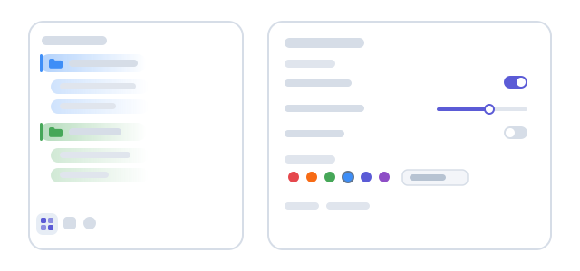

# dsh-project-shader · 项目着色器

[](https://www.npmjs.com/package/dsh-project-shader)
[](https://github.com/omnifj/dsh-project-shader/blob/main/LICENSE)
[](https://www.npmjs.com/package/@deepseek-ai/dsh)

给 **DeepSeek Harness** 左侧工作区侧边栏里的每个项目自动分配专属颜色，并让它的会话行继承同色的浅色底纹。多个项目并排时，一眼就能分清哪个会话属于哪个项目。



---

## 目录

- [功能特性](#功能特性)
- [安装](#安装)
  - [方式一：插件页面（桌面版 / Web，推荐）](#方式一插件页面桌面版--web推荐)
  - [方式二：npm + dsh CLI](#方式二npm--dsh-cli)
  - [方式三：GitHub 直装](#方式三github-直装)
  - [方式四：本地 tarball](#方式四本地-tarball)
  - [方式五：本地目录（改代码时用）](#方式五本地目录改代码时用)
  - [安装后确认](#安装后确认)
- [使用](#使用)
  - [设置面板](#设置面板)
  - [右键菜单快速换色](#右键菜单快速换色)
  - [全部设置项](#全部设置项)
- [颜色是怎么分配的](#颜色是怎么分配的)
- [数据与隐私](#数据与隐私)
- [兼容性](#兼容性)
- [已知限制](#已知限制)
- [更新与卸载](#更新与卸载)
- [开发](#开发)
- [English](#english)
- [License](#license)

---

## 功能特性

- **项目行整行着色**：在每个项目行左侧画一条竖向色条 `|`（内阴影实现，不产生布局位移），并铺一层从左到右、到指定像素处完全透明的颜色渐变。
- **文件夹图标同步染色**：项目行的文件夹图标和展开箭头使用同一个项目色，视觉上更成组。
- **会话行继承同色**：项目下的每个会话行铺一层更浅的同色渐变，形成「项目 → 会话」的层级感；归档会话默认保持朴素灰色，可单独开启。
- **自动配色且互不重复**：未手动指定颜色的项目按工作区 ID 做稳定哈希取色，并在当前项目集合内避让，尽量让每个项目拿到不同的颜色；增删项目时自动色可能顺移。
- **每个项目可单独定制**：10 色调色板、任意自定义 hex、恢复自动、或干脆「不着色」。
- **右键快速换色**：项目标题右键菜单里直接选「项目颜色」，不用打开设置面板。
- **完整设置面板**：渐变开关/浓度/范围、竖线开关/宽度、图标着色、归档行着色，全部带默认值提示，可一键全部恢复默认。
- **中英双语**：界面文案跟随应用语言，除应用语言为英语外默认中文。
- **纯前端、零依赖**：只注入生成好的 CSS 规则，不替换宿主组件、不改布局、不发起任何网络请求。

## 安装

> 前置条件：DeepSeek Harness **0.2.2-rc.5 及以上、0.3.0 以下**（包内 `engines.dsh` 在安装和启动时校验）。浏览器需支持 CSS `color-mix()`（Chrome/Edge 111+、Firefox 113+、Safari 16.2+）。

> **关于 profile**：桌面版使用独占的 `desktop` profile，只能通过应用内的插件页面管理，命令行 `dsh plugin --profile desktop ...` 会被应用拒绝。下面命令行示例中的 `web` 可替换成你的实际 profile 名（如 `tui` 或自定义 profile）。

### 方式一：插件页面（桌面版 / Web，推荐）

不需要命令行，桌面版用户请用这个方式：

1. 打开侧边栏的 **Plugins**（插件）页面。
2. 点右上角 **Add plugin**（添加插件）。
3. 在包名输入框里填入：

   ```text
   dsh-project-shader
   ```

4. 点 **Install** 安装；若提示选择 registry，保持默认即可（官方 npm 源，或已同步该包的 npmmirror 镜像都行）。
5. 安装完成后点 **Enable now**（立即启用），插件会出现在 **Installed plugins** 里。

装好后立即生效，无需重启。

### 方式二：npm + dsh CLI

已安装 `dsh` 命令行、或使用 Web/TUI profile 的用户：

```bash
# 装到指定 profile（把 web 换成你实际启动的 profile 名）
dsh plugin --profile web add dsh-project-shader

# 然后正常启动该 profile
dsh --profile web
```

需要固定版本时：

```bash
dsh plugin --profile web add dsh-project-shader@1.0.0
```

`dsh plugin` 会调用 pnpm 安装包、把 bundle 追加到 profile 的 `dsh.profile.bundles` 列表并启用对应插件行。该包是纯 JavaScript，**没有构建脚本**，安装时不会执行任何安装脚本，也不需要 `allowBuilds` 授权。

> 如果 profile 用 HMR 运行，改动会即时热加载；否则重启 `dsh --profile <name>` 后生效。

### 方式三：GitHub 直装

不想经过 npm 源（或想直接跟仓库最新代码）时：

```bash
dsh plugin --profile web add github:omnifj/dsh-project-shader
```

建议锁定 tag 或 commit，避免上游代码变动影响你的环境：

```bash
dsh plugin --profile web add github:omnifj/dsh-project-shader#v1.0.0
```

同样因为包内没有 `prepare`/`build` 脚本，GitHub 安装开箱即用，不需要为构建脚本授权。

### 方式四：本地 tarball

离线机器、或想先审计再装：

```bash
# 方式 A：从 GitHub Release 下载 dsh-project-shader-1.0.0.tgz 后
dsh plugin --profile web add ./dsh-project-shader-1.0.0.tgz

# 方式 B：自己从 npm 打包
npm pack dsh-project-shader
dsh plugin --profile web add ./dsh-project-shader-1.0.0.tgz
```

tarball 同时也是最简单的「审计单位」：解压后只有 `index.js`、`client.js`、`cordis.patch.yml`、`locale/`、`docs/`、`icon.svg`，没有依赖、没有安装脚本。

> 桌面版用户也可以用插件页面的 **Add plugin** 填入 tarball 的绝对路径来安装。

### 方式五：本地目录（改代码时用）

```bash
# 开发时把工作区目录直接 link 进 profile（CLI profile，如 web）
dsh plugin --profile web add D:/Project/dsh-plugin/dsh-project-shader
```

桌面版则用 **Plugins → Add plugin** 填目录绝对路径，效果相同。

本方式 pnpm 会创建 `link:` 依赖：修改 `client.js` 后刷新页面或重启 DSH 即可看到效果，不用反复重装。发布前建议用打包产物再验证一次，因为 `files` 字段只对打包生效、对 link 目录不过滤。

### 安装后确认

- **Plugins** 页面 → **Installed plugins** 里出现 **Project shader / 项目着色器**，开关为开。
- 侧边栏底部图标列多出一个四宫格图标，点击打开设置面板。
- 左侧任意项目行出现竖向色条和渐变底纹，其会话行出现同色浅底纹。

## 使用

### 设置面板

点击侧边栏底部图标列里的「项目着色」图标（四宫格）打开设置面板。面板分三段：

- **项目行**：项目行的渐变、浓度、范围、竖线、竖线宽度、图标着色。
- **会话行**：会话行的渐变、浓度、范围，以及归档会话是否着色。
- **项目颜色**：逐个项目选择调色板颜色、输入自定义 hex、点「自动」恢复哈希分配、或点「不着色」让该项目完全不上色。

每行右侧都标注了该设置的出厂默认值；面板右上角「全部恢复默认值」只重置上面这些全局参数，不会清掉你为项目挑的颜色（项目颜色用各自的「自动」按钮复原）。

### 右键菜单快速换色

在项目标题上点右键，菜单里有 **Project color / 项目颜色** 子菜单：10 个色板 + 「自动」，当前生效项会带「（当前）」标记并置灰。子菜单底部还有「打开着色设置」，直接跳到设置面板。

### 全部设置项

| 设置 | 作用范围 | 默认值 | 可调范围 |
|---|---|---|---|
| 颜色渐变 | 项目行 | 开 | 开 / 关 |
| 渐变浓度 | 项目行 | `20%` | 0–60% |
| 渐变范围 | 项目行 | `48px` | 16–200px |
| 项目竖线「\|」 | 项目行 | 开 | 开 / 关 |
| 竖线宽度 | 项目行 | `3px` | 1–12px |
| 文件夹图标着色 | 项目行 | 开 | 开 / 关 |
| 颜色渐变 | 会话行 | 开 | 开 / 关 |
| 渐变浓度 | 会话行 | `14%` | 0–60% |
| 渐变范围 | 会话行 | `56px` | 16–200px |
| 归档会话也着色 | 会话行 | 关 | 开 / 关 |
| 项目颜色 | 单个项目 | 自动 | 10 色板 / 自定义 hex / 自动 / 不着色 |

调色板固定为 10 个中间调颜色，在浅色和深色主题下都保持可读：

`#e5484d` 红 · `#f76b15` 橙 · `#e8930c` 琥珀 · `#46a758` 绿 · `#12a594` 青 · `#3e8ef7` 蓝 · `#5b5bd6` 靛 · `#8e4ec6` 紫 · `#d6409f` 粉 · `#8b8d98` 灰

## 颜色是怎么分配的

1. 你手动指定过颜色的项目，永远优先使用你指定的颜色；指定「不着色」的项目直接跳过。
2. 其余项目按 `workspaceId` 做 FNV-1a 哈希，映射到 10 色板的某一格。
3. 如果这一格已经被手动占用、或已被先分配的项目占用，就按固定顺序往后找下一个空位（按 `workspaceId` 排序遍历，结果可复现）。
4. 所以：**同样的项目集合 = 同样的配色**；增加或删除项目时自动色可能变化，手动指定的颜色不会。

## 数据与隐私

- 所有设置只写入当前浏览器的 `localStorage`，键名为 `dsh-project-shader:settings:v2`。
- 不会上传、不会跨设备或浏览器同步、不会写入 DSH 的 profile 配置。
- 旧版（`dsh-project-shader:colors:v1`）的每项目颜色会在首次加载时一次性迁移到新键，旧键随即删除。
- 清除站点数据 / 换浏览器 / 换端口访问，都会回到出厂默认外观。
- 插件不发起任何网络请求，不读取会话内容或项目路径以外的信息。

## 兼容性

- DeepSeek Harness `>=0.2.2-rc.5 <0.3.0`（由 `engines.dsh` 声明，安装与启动时会校验）。
- 仅 Web 渲染端（桌面版与 `dsh web` 都适用）；依赖 Client 侧以下插件的插槽：`dsh-client-ui-context-menu`、`dsh-client-ui-layout`、`dsh-client-ui-sidebar`、`dsh-client-ui-workspace`。
- 浏览器需支持 CSS `color-mix()`。
- 浅色 / 深色主题都可用：颜色用 `color-mix()` 与主题变量混合，不写死背景色。

## 已知限制

- 着色依赖宿主行元素上的 `data-row-key="workspace:<id>"` / `data-row-key="session:<id>"` 属性。如果未来 DSH 版本改了行 key 的命名，颜色会直接失效（不会报错、不影响其它功能），届时需要升级本插件。
- 开启「文件夹图标着色」后，项目行的文件夹图标会用项目色，这会盖住宿主原本表示「该行包含当前会话」的高亮色。想保留宿主高亮，请关掉这一项。
- 自动配色是在「当前项目集合」内避让的，所以项目增删后自动色可能顺移，这是设计行为而非 bug。
- 设置按浏览器存储，不跟随 DSH 账号；桌面版与 Web 版、不同端口之间不共享。
- 与其它直接改宿主行样式的插件可能互相覆盖，建议只保留一个同类着色插件。

## 更新与卸载

**更新**：插件页面里对第三方插件采用「卸载再安装」的方式升级：

```bash
dsh plugin --profile web remove dsh-project-shader
dsh plugin --profile web add dsh-project-shader@1.1.0
```

或在 **Plugins** 页面里卸载后重新安装。升级不会清掉你的 `localStorage` 设置（键名不变）。

**停用/卸载**：

```bash
dsh plugin --profile web remove dsh-project-shader
```

或在插件页面关掉开关 / 点卸载。停用后侧边栏立即恢复原始外观，重装后颜色设置仍在。

## 开发

```text
dsh-project-shader/
├── package.json         # 包清单：dsh.bundle + dsh.client + files
├── cordis.patch.yml     # bundle 层：插入一行插件
├── index.js             # Host 半身（空实现，渲染全在 Client）
├── client.js            # Client 半身：注入 CSS、设置面板、右键菜单
├── locale/en.json       # 英文显示元数据 + 插件页面长描述
├── locale/zh.json       # 中文显示元数据 + 插件页面长描述
├── docs/DETAIL.md       # 插件详情页配图（英文）
├── docs/DETAIL.zh.md    # 插件详情页配图（中文）
├── docs/preview.svg     # 功能预览图
└── icon.svg             # 插件图标
```

- Host 半身 `index.js` 只导出空的 `apply()`；所有渲染逻辑在浏览器端 `client.js`，通过 `window.__ModuleLoader__.load({ id: 'dsh-project-shader', factory })` 注册工厂，工厂 id 必须与包名一致。
- 生成的 CSS 全部挂在 `shell.overlay`（整帧常驻、点击穿透的覆盖层）里的一个 `<style>` 上；不插入额外 DOM，因此不会挤占布局。
- 本地开发推荐 link 目录：CLI profile 用 `dsh plugin --profile web add <本目录绝对路径>`，桌面版用 **Plugins → Add plugin** 填绝对路径。改完刷新页面即可。
- 发布前自检：

  ```bash
  node --check index.js && node --check client.js
  npm pack --dry-run    # 确认打包文件列表
  npm publish           # 需要已登录 npm 账号
  ```

## English

**dsh-project-shader** colors every project in the DeepSeek Harness workspace sidebar and tints the sessions underneath it.

- Each project row gets an inset `|` color bar, a left-to-right gradient wash over the folder-icon cell, and a tinted folder glyph.
- Session rows under a project inherit a lighter wash in the same color; archived sessions stay plain unless you opt in.
- Unassigned projects get a stable hash-based palette color, shifted to the next free slot so two projects do not share one while a slot remains.
- A **Project shader** panel (sidebar bottom icon column) exposes every global parameter; a project's right-click menu offers **Project color** for quick changes.
- Everything persists in `localStorage` only (`dsh-project-shader:settings:v2`); nothing is uploaded.

Install (pick one):

```bash
# A. Plugins page → Add plugin → dsh-project-shader → Install → Enable now
# B. npm + CLI (desktop profile is managed by the Desktop app; use the UI there)
dsh plugin --profile web add dsh-project-shader
# C. straight from GitHub (pin a tag to stay stable)
dsh plugin --profile web add github:omnifj/dsh-project-shader#v1.0.0
# D. local tarball
dsh plugin --profile web add ./dsh-project-shader-1.0.0.tgz
# E. local directory (development link)
dsh plugin --profile web add D:/path/to/dsh-project-shader
```

Requires DeepSeek Harness `>=0.2.2-rc.5 <0.3.0` and a browser with CSS `color-mix()` support. Pure client-side CSS generation: no dependencies, no install scripts, no network requests.

## License

[MIT](https://github.com/omnifj/dsh-project-shader/blob/main/LICENSE) © 2026 omnilm
